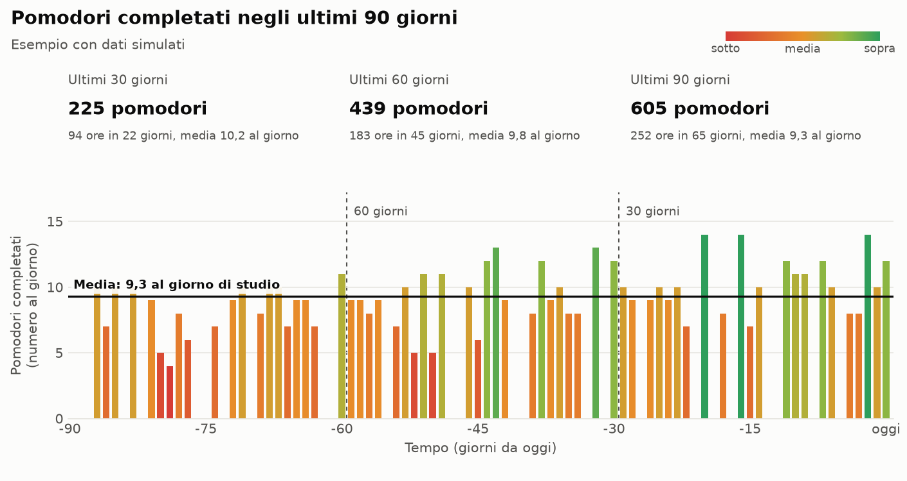

# 🍅 Pomodori

Pianificatore di giornate di studio con timer pomodoro. Inserisci l'ora di inizio, l'ora di fine e quando vuoi fare le pause pasto: pomodori e pause vengono calcolati in automatico, con una campanella alla fine di ogni blocco.

**[Prova la demo online](https://elenasorrentino10.github.io/Pomodori_Analysis/)**


> [!WARNING]
> **I tuoi dati restano solo in questo browser, su questo dispositivo.** Non c'è un account e non esiste una copia online: programma, note, post-it e riflessione non vengono salvati da nessun'altra parte.
>
> **Se chiudi la pagina o spegni il computer non perdi nulla:** riaprendo Pomodori nello stesso modo ritrovi tutto.
>
> **Perdi i dati se:**
> - usi una finestra in incognito e la chiudi;
> - cancelli i dati di navigazione del browser;
> - sposti o riscarichi la cartella del progetto, oppure cambi indirizzo della pagina.
>
> **Non li ritrovi se** apri Pomodori con un altro browser o su un altro dispositivo.
>
> Non esiste ancora uno storico: viene conservata una sola riflessione alla volta e "Azzera riflessione" la cancella. Se vuoi tenere qualcosa, copialo altrove.

## Funzionalità

- Programma calcolato da ora di inizio e ora di fine: entrano tutti i pomodori e le pause che ci stanno, senza superare l'ora di fine.
- Una o più pause pasto, ognuna con il proprio orario e la propria durata: iniziano esattamente all'ora scelta, senza spezzare un pomodoro.
- Durate di pomodori e pause configurabili.
- Orari modificabili direttamente nella lista.
- Timer per ogni blocco, con campanella e avvio automatico del blocco successivo.
- Notifiche facoltative quando la pagina non è in primo piano.
- Progressi e timer salvati nel browser: ricaricando la pagina il timer riprende.
- Annullamento dell'ultima modifica.
- Note su ogni pomodoro e su ogni pausa.
- Post-it laterale per annotare i pensieri che arrivano mentre studi.
- Riflessione guidata a fine sessione: un voto per area (emotiva, fisica, mentale, ambientale, digitale, organizzazione, materiale di studio, motivazione, persone e imprevisti), i problemi emersi e suggerimenti pratici.
- Punteggio finale su 100, calcolato per il 70% dai voti e per il 30% dai pomodori completati.

Nessun dato lascia il browser: non ci sono account, server o librerie esterne.

I suggerimenti della riflessione sono consigli generali di organizzazione dello studio e non sostituiscono il parere di un medico o di un professionista.

## Come usarlo

Apri la [demo online](https://elenasorrentino10.github.io/Pomodori_Analysis/), oppure scarica il repository e apri `index.html` nel browser: non serve installare nulla.

La pagina deve restare aperta perché la campanella possa suonare. I browser possono rallentare le schede in background, quindi l'avviso può arrivare con qualche secondo di ritardo.

## Struttura

```
index.html            struttura della pagina
style.css             stile
app.js                timer, interfaccia e salvataggio
schedule.js           logica degli orari, senza dipendenze dalla pagina
review.js             domande, punteggio e suggerimenti della riflessione finale
tests/                test della logica
```

## Test

Con Node.js 20 o superiore:

```bash
npm test
```

## Sviluppi futuri

Storico delle sessioni e statistiche, senza librerie esterne né account:

- **Salvataggio:** un pulsante "Chiudi e salva sessione" in fondo alla riflessione, che registra data, pomodori previsti e completati, minuti di studio stimati, voti per area, problemi segnati, punteggio e risposte finali, poi azzera spunte e riflessione.
- **Storico:** elenco delle sessioni con data, pomodori e punteggio, con dettagli ed eliminazione.
- **Statistiche in breve**, con filtro per 7 giorni, 30 giorni o tutto: sessioni totali, ore di studio, percentuale di pomodori completati, punteggio medio e giorni consecutivi.
- **Grafici sui pomodori:** completati e previsti per giorno, ore di studio per settimana.
- **Grafici sulla riflessione:** andamento del punteggio, media per area, problemi più frequenti.
- **Backup:** esportazione e importazione in un file, perché i dati restano nel browser. Il file conterrà risposte personali e non va pubblicato.

Le due immagini mostrano come potrebbero apparire le statistiche su 30, 60 e 90 giorni. **Sono esempi con dati simulati:** questa funzione non è ancora presente nell'app.




**Lettura degli ultimi 30 giorni** *(esempio con dati simulati)*

**Cosa sta migliorando:** Mentale, Digitale e Organizzazione crescono di 0,6 punti rispetto alla media degli ultimi 90 giorni. Annota cosa hai cambiato, così puoi continuare a farlo.

**Da cosa partire:**

1. **Persone e imprevisti (2,5, in calo di 0,7).** Comunica in anticipo gli orari di studio e proponi di rispondere nelle pause. Lascia anche un margine nel programma per gli imprevisti.
2. **Fisico (3,3, in calo di 0,3).** Regola sedia e schermo, e usa le pause per alzarti e muoverti. Se il dolore persiste, parlane con un medico.

> **Nota:** nell'app i consigli verranno scelti in base ai problemi segnati più spesso in ogni area, non solo in base al voto. Un voto basso su "Fisico", per esempio, può indicare stanchezza oppure mal di schiena, e le soluzioni sono diverse.

## Stato del progetto

Prossimi passi:

- provare campanella e notifiche;
- ridurre la frizione di UX/UI;
- citare storico e statistiche nella descrizione del repository quando saranno disponibili nell'app.

## Licenza

[MIT](LICENSE)
