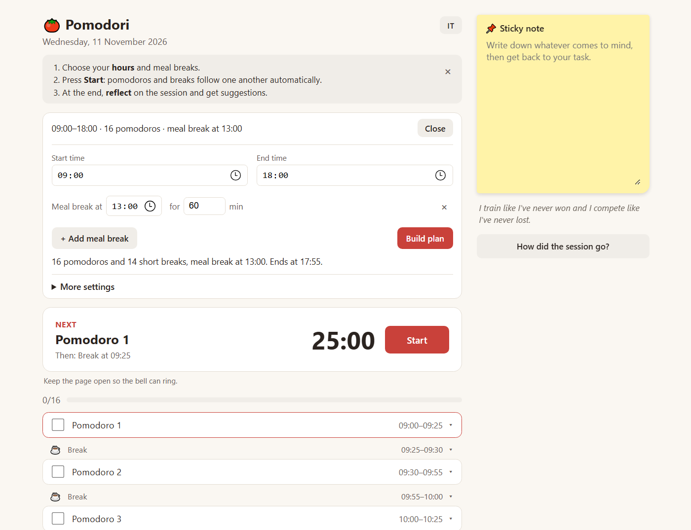
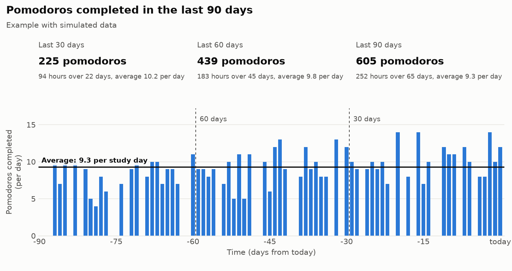

# 🍅 Pomodori

A study day planner with a pomodoro timer. Enter your start time, your end time and when you want your meal breaks: pomodoros and breaks are calculated automatically, with a bell at the end of each block. The app is available in English and Italian.

**[Try the online demo](https://elenasorrentino10.github.io/Pomodori_Analysis/)**



> [!WARNING]
> **Your data stays only in this browser, on this device.** There is no account and no online copy: your plan, notes, sticky note and reflection are not saved anywhere else.
>
> **Closing the page or turning off your computer does not lose anything:** open Pomodori the same way and everything is still there.
>
> **You lose your data if you:**
> - use a private window and close it;
> - clear your browser data;
> - move or download the project folder again, or open the page from a different address.
>
> **You will not find it** if you open Pomodori in another browser or on another device.
>
> There is no history yet: only one reflection is kept at a time, and "Reset reflection" deletes it. If you want to keep something, copy it somewhere else.

## Features

- Day plan built from a start and an end time: every pomodoro and break that fits is added, without going past the end time.
- One or more meal breaks, each with its own time and length. They start exactly at the chosen time, without splitting a pomodoro.
- Current block highlighted, with a large timer, a Start/Pause button and the next block.
- A compact list: each row opens to edit its times, write a note or reset its timer.
- Configurable pomodoro and break lengths.
- A timer for every block, with a bell and an automatic start of the next block.
- Optional notifications when the page is in the background.
- Progress and timers saved in the browser: when you reload the page, the timer resumes.
- Undo for the last change.
- A sticky note on the side for the thoughts that come up while you study.
- A guided reflection at the end of the session, in a side panel with one area at a time: a rating for each area (emotional, physical, mental, environment, digital, organization, study material, motivation, people and unexpected events), the problems that came up and practical suggestions.
- A final score out of 100, based 70% on the ratings and 30% on the completed pomodoros.
- English and Italian interface, chosen from the browser language and switchable at any time.

No data leaves the browser: there are no accounts, servers or external libraries.

The reflection suggestions are general study organization tips and do not replace the advice of a doctor or another professional.

## How to use it

Open the [online demo](https://elenasorrentino10.github.io/Pomodori_Analysis/), or download the repository and open `index.html` in your browser: nothing needs to be installed.

To open the demo directly in one language, add `?lang=en` or `?lang=it` to the address.

The page must stay open for the bell to ring. Browsers can slow down background tabs, so the alert may arrive a few seconds late.

## Project structure

```
index.html            page structure
style.css             styles
app.js                timer, interface and saving
schedule.js           scheduling logic, independent of the page
review.js             questions, scoring and suggestions of the reflection
i18n.js               interface text in English and Italian
tests/                logic tests
```

## Tests

With Node.js 20 or later:

```bash
npm test
```

## Future development

Session history and statistics, without external libraries or accounts:

- **Saving:** a "Close and save session" button at the end of the reflection, which records the date, planned and completed pomodoros, estimated study minutes, area ratings, selected problems, score and final answers, then resets checkmarks and reflection.
- **History:** a list of sessions with date, pomodoros and score, with details and deletion.
- **Quick statistics**, filtered by 7 days, 30 days or all time: total sessions, study hours, share of completed pomodoros, average score and consecutive days.
- **Pomodoro charts:** completed and planned pomodoros per day, study hours per week.
- **Reflection charts:** score over time, average per area, most frequent problems.
- **Backup:** export and import to a file, because the data stays in the browser. The file will contain personal answers and should not be published.

The two images show how statistics over 30, 60 and 90 days could look. **They are examples with simulated data:** this feature is not in the app yet.




**Reading of the last 30 days** *(example with simulated data)*

**What is improving:** Mental, Digital and Organization are up 0.6 points compared with the average of the last 90 days. Write down what you changed so you can keep doing it.

**Where to start:**

1. **People and unexpected events (2.5, down 0.7).** Tell people your study hours in advance and offer to reply during breaks. Also leave some slack in the plan for the unexpected.
2. **Physical (3.3, down 0.3).** Adjust your chair and screen, and use breaks to stand up and move. If the pain persists, talk to a doctor.

> **Note:** in the app, suggestions will be chosen from the problems selected most often in each area, not only from the rating. A low "Physical" rating, for example, can mean tiredness or back pain, and the solutions are different.

## Project status

Next steps:

- test the bell and notifications;
- mention history and statistics in the repository description once they are available in the app.

## License

[MIT](LICENSE)
